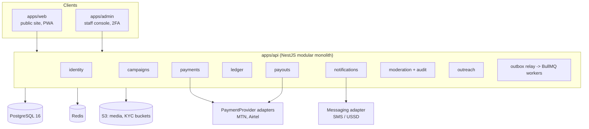
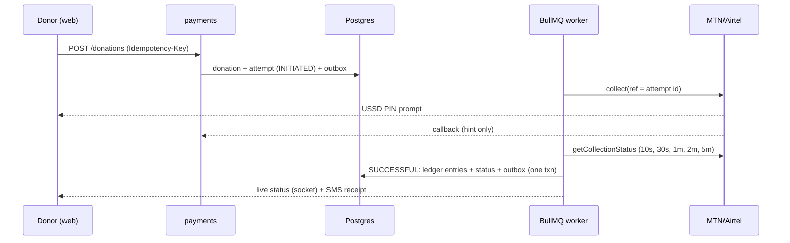

# Architecture overview

The full reasoning is in [SPEC.md → Architecture and tech stack](../product/SPEC.md#architecture-and-tech-stack); decisions are recorded in [decisions/](decisions/). This page is the working map engineers keep open.

## Shape: a modular monolith

There is one deployable NestJS backend, split into strict modules. Web (Next.js), admin (a separate Next.js app) and later an Android app are clients. MTN, Airtel, SMS, storage and AI sit behind adapters.



## Modules and what they own

| Module          | Owns (tables)                                                                           | Publishes events (examples)                       | Feature IDs   |
| --------------- | --------------------------------------------------------------------------------------- | ------------------------------------------------- | ------------- |
| `identity`      | users, kyc_verifications, sessions, groups, group_members                               | UserVerified, KycRejected                         | A-_, G-_      |
| `campaigns`     | campaigns, beneficiaries, campaign_media, campaign_updates, (later) pledges, milestones | CampaignPublished, CampaignVerified, UpdatePosted | C-_, V-_, U-* |
| `payments`      | donations, payment_attempts                                                             | DonationConfirmed, DonationFailed                 | D-*           |
| `ledger`        | ledger_accounts, ledger_entries                                                         | (none; called synchronously inside transactions)  | F-06          |
| `payouts`       | payout_destinations, payouts                                                            | PayoutRequested, PayoutSent                       | P-*           |
| `notifications` | notifications, templates                                                                | (none)                                            | N-*           |
| `moderation`    | reports, audit_logs                                                                     | CampaignFlagged                                   | T-*           |
| `outreach`      | share links, share stats                                                                | (none)                                            | O-*           |
| platform        | outbox_events                                                                           | (none)                                            | F-09          |

**Rules**

- A module touches only its own tables. Other modules use its exported service or listen to its events.
- `ledger` is the one module others call _synchronously_ inside a transaction, because the ledger write must commit atomically with the business change. It exposes a narrow API (`post(txn)` and `balance(account)`) and nothing else.
- Cross-module flows use events through the outbox. For example: DonationConfirmed leads to `notifications` sending a receipt and `campaigns` updating its live total.

## The donation path, end to end



## Target code layout

This gets created during Phase 0 (F-01). Keep to it so the codebase stays predictable.

```
apps/
  api/
    src/
      main.ts
      app.module.ts
      config/                  # Zod-validated env config
      common/                  # cross-cutting: errors, logging, auth guards, idempotency, money
      modules/
        identity/
          identity.module.ts
          identity.service.ts  # public interface, the only thing other modules import
          http/                # controllers + request/response mapping
          domain/              # entities, policies (canWithdraw…), domain errors
          infra/               # Drizzle repositories, adapters
          events.ts            # events this module publishes
          *.spec.ts
        campaigns/  payments/  ledger/  payouts/  notifications/  moderation/  outreach/
      integrations/
        payment-providers/     # PaymentProvider interface, mtn/, airtel/, fake/
        messaging/             # Messaging interface, sms provider adapters, fake/
        storage/
      jobs/                    # BullMQ queues and workers, outbox relay
      db/
        schema/                # Drizzle schema, one file per module
        migrations/            # SQL migrations (forward-only)
    test/                      # integration + e2e tests
  web/                         # Next.js public site (app router), responsive: phone and desktop
    src/app/                   #   routes only (thin): load data, render one feature component
    src/features/<area>/       #   one folder per product area (auth, campaigns, donate…)
    src/components/ui/         #   design-system primitives (colour tokens, buttons, inputs)
    src/lib/api/               #   typed API client using the shared Zod schemas
  admin/                       # Next.js staff console
packages/
  shared/                      # Zod schemas, DTOs, Ngwee, phone utils, error codes, campaign types
  config/                      # tsconfig / eslint / prettier presets
infra/                         # Terraform (AWS af-south-1)
docs/                          # you are here
```

Every adapter has a **`fake/` implementation** used in unit tests and local dev, so the app runs end to end without network access. Contract tests run the real adapters against the sandboxes.
