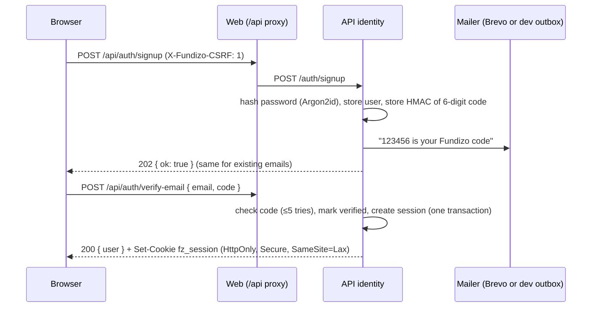

# A-01 — Email sign-up and login (with sessions, A-03)

|                 |                                                                                                                                                                                    |
| --------------- | ---------------------------------------------------------------------------------------------------------------------------------------------------------------------------------- |
| **Feature IDs** | A-01 (email sign-up and login), A-03 (sessions, log out, log out of other devices)                                                                                                 |
| **Phase**       | 1 · MVP slice 1                                                                                                                                                                    |
| **Status**      | Shipped                                                                                                                                                                            |
| **Module(s)**   | API `modules/identity`, `infra/mail`; web `features/auth`; shared `auth.ts`, `errors.ts`                                                                                           |
| **ADRs**        | [0004 Accounts](../architecture/decisions/0004-accounts-email-google-phone-later.md), [0002 Providers (Brevo)](../architecture/decisions/0002-mvp-providers-zynlepay-brevo-aws.md) |

## 1. Summary

People create an account with their name, email and a password. We email a 6-digit code (Brevo), and entering it confirms the email and signs them in. They can log in and out, log out of their other devices, and reset a forgotten password by email link. Google sign-in (A-12) and phone verification (A-13) come in the next slices.

## 2. Screens (responsive, light and dark)

| Route                     | Purpose                                                                                                                                             |
| ------------------------- | --------------------------------------------------------------------------------------------------------------------------------------------------- |
| `/signup`                 | Name, email, password (show/hide; live "10+ characters" check)                                                                                      |
| `/verify-email`           | 6-digit code; submits by itself when 6 digits are typed or pasted; "send a new code" with a 60 s cooldown. The email link pre-fills email and code. |
| `/login`                  | Email, password, "Forgot password?"; unverified accounts are sent to the code screen with a fresh code                                              |
| `/forgot-password`        | Email → neutral "if there's an account…" message                                                                                                    |
| `/reset-password?token=…` | New password → signed in; other devices logged out                                                                                                  |
| `/account`                | Name, email (confirmed badge), member since; log out; log out of other devices                                                                      |
| `/dev/outbox`             | **Development only.** Emails captured when no Brevo key is set                                                                                      |

Each account screen pairs the form with an illustration telling part of the Fundizo story (community → mobile money → one goal → verified and safe). Desktop: panel left, form right. Phone: compact illustration band above the form. All text uses the fluid type scale (`text-sm` … `text-5xl`, clamp-based) defined in `globals.css`.

## 3. Flow



## 4. API

All bodies are validated with the shared Zod schemas (unknown fields rejected). Every POST needs `X-Fundizo-CSRF: 1`. Errors are always `{ error: { code, message, fields?, retryAfter? } }`.

| Method & path                    | Body                   | Success                        | Notes                                                                                                                            |
| -------------------------------- | ---------------------- | ------------------------------ | -------------------------------------------------------------------------------------------------------------------------------- |
| `POST /auth/signup`              | `SignupRequest`        | 202 `{ ok }`                   | Existing verified email → "you already have an account" email; existing unverified → fresh code; never changes a stored password |
| `POST /auth/verify-email`        | `VerifyEmailRequest`   | 200 `SessionResponse` + cookie | `invalid_code`, `code_expired`, `too_many_attempts`                                                                              |
| `POST /auth/resend-verification` | `EmailOnlyRequest`     | 202 `{ ok }`                   | 3 per 15 min per email                                                                                                           |
| `POST /auth/login`               | `LoginRequest`         | 200 `SessionResponse` + cookie | `invalid_credentials` (generic), `email_not_verified` (403, new code sent)                                                       |
| `POST /auth/password/forgot`     | `EmailOnlyRequest`     | 202 `{ ok }`                   | Link valid 30 min, once                                                                                                          |
| `POST /auth/password/reset`      | `ResetPasswordRequest` | 200 `SessionResponse` + cookie | Verifies the email too; revokes all other sessions                                                                               |
| `GET /auth/me`                   | —                      | 200 `SessionResponse`          | 401 `unauthenticated` without a valid session                                                                                    |
| `POST /auth/logout`              | —                      | 204                            | Revokes the session, clears the cookie                                                                                           |
| `POST /auth/logout-others`       | —                      | 200 `{ revoked }`              | Keeps the current session                                                                                                        |
| `GET /dev/outbox`                | —                      | 200                            | Not registered when `NODE_ENV=production`                                                                                        |

## 5. Data model (migration `0001_identity`)

- `users`: email (unique, case-insensitive), `email_verified_at`, first/last name, `password_hash` (Argon2id PHC, nullable for Google-only later), status (`active`/`disabled`, CHECK constraint).
- `sessions`: `token_hash` (unique HMAC), expires (30 days), `revoked_at`, `last_seen_at`, user agent, IP.
- `one_time_tokens`: purpose (`verify_email`/`reset_password`, CHECK), `token_hash`, expiry, `consumed_at`, `attempts`.

## 6. Email (Brevo)

Templates live in `apps/api/src/infra/mail/templates.ts`: verify-email (code + link), account-exists, reset-password, password-changed. Each has a text version, and user input is escaped. With no `BREVO_API_KEY`, emails go to the dev outbox (Redis, last 50). **Production refuses to start without a Brevo key.**

### Setting up Brevo

1. **Create an API key.** In Brevo, open the menu under your name (top right) → **SMTP & API** → **API keys** → **Generate a new API key**. Copy it; it starts with `xkeysib-`.
2. **Verify a sender.** Go to **Senders, Domains & Dedicated IPs** → **Senders** → **Add a sender**, using the address emails will come from. Click the link Brevo emails you. (Later, authenticate your whole domain there too, for better delivery.)
3. **Add both to `apps/api/.env`** (this file is git-ignored; never commit it):

   ```dotenv
   BREVO_API_KEY=xkeysib-...your key...
   MAIL_FROM_EMAIL=the-sender-you-verified@yourdomain.com
   MAIL_FROM_NAME=Fundizo
   ```

4. **Restart `pnpm dev`.** The API logs a warning while emails still go to the dev outbox. With the key set, sign-up emails arrive in real inboxes.

In production these values come from AWS Secrets Manager (slice 7), never from a file.

## 7. Security & privacy

- **Who can do what:** anyone can sign up or log in. Only a valid session reaches `/auth/me` and `/auth/logout-others`.
- **Inputs:** shared Zod schemas, strict (no mass assignment); email trimmed and lower-cased; names ≤ 60; passwords 10–128 characters.
- **Secrets at rest:** Argon2id for passwords; HMAC-SHA256 keyed with `AUTH_SECRET` for codes, reset tokens and session tokens. Nothing reversible is stored.
- **Enumeration:** identical responses for existing and unknown emails; dummy password hashing for unknown accounts; one generic login error.
- **Abuse:** Redis rate limits on every endpoint (keys hash the email); 5 tries per code; resend cooldown; the "already have an account" email is limited to 3 an hour.
- **Takeover defences:** a second sign-up never overwrites an unverified account's password; reset logs out every device; a "password changed" email goes to the owner.
- **Cookies and CSRF:** `HttpOnly; Secure; SameSite=Lax`, plus the required CSRF header; same-origin `/api` proxy; no CORS.
- **Logs:** request bodies, cookies, authorization headers, passwords, codes and tokens are redacted; emails are logged by tag only.
- **No PII in URLs we create:** the sign-up → code screen hand-off uses `sessionStorage`. The emailed verification link does carry the email and code: it's the person's own inbox, the code is short-lived, and it's single-use.

## 8. Failure modes & edge cases

| Situation                                                   | What happens                                                                                   | Test                  |
| ----------------------------------------------------------- | ---------------------------------------------------------------------------------------------- | --------------------- |
| Email already registered                                    | Same 202; owner gets "already have an account"                                                 | ✅ API                |
| Second sign-up on an unverified email with another password | Password unchanged; a fresh code goes to the real inbox owner                                  | ✅ API                |
| Wrong code ×5                                               | Code locked; must ask for a new one                                                            | ✅ API                |
| Old code after a resend                                     | Rejected; only the newest works                                                                | ✅ API                |
| Unverified login                                            | 403 + new code; UI goes to the code screen                                                     | ✅ API + web          |
| Reset link reused or expired                                | `invalid_token`, with a "get a new link" button                                                | ✅ API                |
| Missing CSRF header                                         | 403 `csrf_failed`                                                                              | ✅ API                |
| Brevo down or bad key                                       | Logged, response unchanged; the person can resend. (Retries via the job queue come with F-09.) | ✅ unit (Brevo error) |
| Refresh on the code screen                                  | Email kept in `sessionStorage`; otherwise asks for it                                          | ✅ web                |

## 9. Testing

- **API** (real Postgres `fundizo_test` + Redis DB 15, emails read from the outbox): 18 end-to-end auth tests, password hashing and tokens, Brevo adapter, config.
- **Web:** form tests (validation, CSRF header, field errors, redirects, auto-submit, neutral forgot message), header states, safe `next` redirects.
- **Manual / browser:** full flow in Chromium (sign up → code → account → logout → login → forgot → reset), screenshots at 390 px and 1440 px, light and dark.

## Changelog

| Date       | Change          |
| ---------- | --------------- |
| 2026-11-23 | Slice 1 shipped |
