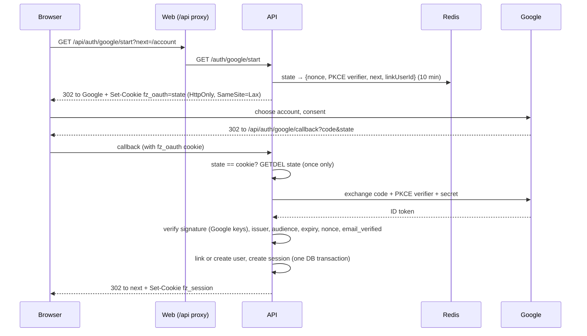

# A-12 — Continue with Google

|                 |                                                                                                                                    |
| --------------- | ---------------------------------------------------------------------------------------------------------------------------------- |
| **Feature IDs** | A-12                                                                                                                               |
| **Phase**       | 1 · MVP slice 2                                                                                                                    |
| **Status**      | Shipped (needs Google credentials to switch on, see below)                                                                         |
| **Module(s)**   | API `modules/identity` (`google-auth.*`), `infra/google`; web `features/auth` (`google-button`, `google-errors`); shared `auth.ts` |
| **ADRs**        | [0004 Accounts](../architecture/decisions/0004-accounts-email-google-phone-later.md)                                               |

## 1. Summary

"Continue with Google" on the log-in and sign-up pages signs people in with one tap. A new person gets an account with their Google name and an already-confirmed email. Someone who already has a Fundizo account with the same confirmed email is signed into that account. Signed-in people can also **Connect Google** from their account page. Google users can add a password at any time through "Forgot password", after which both ways work.

When Google credentials aren't configured, the button simply doesn't appear.

## 2. Linking rules (ADR 0004)

| Situation when Google returns                                | Result                                                                                                                                                                                                       |
| ------------------------------------------------------------ | ------------------------------------------------------------------------------------------------------------------------------------------------------------------------------------------------------------ |
| This Google account (its stable id, `sub`) is already linked | Sign in to that account, even if the Google email changed                                                                                                                                                    |
| A Fundizo account has the same email, **confirmed**          | Link Google to it and sign in; its password keeps working                                                                                                                                                    |
| A Fundizo account has the same email, **not confirmed**      | Google proves the inbox: the email is marked confirmed, the **unproven password is discarded**, old codes and sessions are cancelled. This stops someone pre-registering your email with their own password. |
| No account                                                   | Create one: Google's given and family name, confirmed email, no password                                                                                                                                     |
| Signed in and clicking **Connect Google**                    | Link to the current account (any Google email); refused if that Google account belongs to someone else                                                                                                       |
| Google says the email is **not verified**                    | Refused (`email_unverified`)                                                                                                                                                                                 |

## 3. Flow



## 4. API

| Method & path                       | Answers with                                                                                     | Notes                                                                                                           |
| ----------------------------------- | ------------------------------------------------------------------------------------------------ | --------------------------------------------------------------------------------------------------------------- |
| `GET /auth/providers`               | `{ google: boolean }`                                                                            | The web app shows the button only when `true`                                                                   |
| `GET /auth/google/start?next=/path` | 302 to Google                                                                                    | Sets the `fz_oauth` state cookie (10 min). If already signed in, this is "Connect Google". Rate-limited per IP. |
| `GET /auth/google/callback`         | 302 to `next` (signed in) or `/login?error=google_<reason>` (`/account?error=…` when connecting) | Reasons: `cancelled`, `expired`, `unavailable`, `email_unverified`, `in_use`, `failed`. Never free text.        |

`PublicUser` gained `googleLinked`. The account page shows "Ways to log in": email and password (set, or "Set a password"), and Google (connected, or "Connect Google").

## 5. Data model (migration `0002_google_identities`)

`user_identities`: `user_id`, `provider` (`google`, CHECK), `subject` (Google's `sub`), the Google `email` at link time (kept for support, never used for matching). Unique `(provider, subject)`: one Google account belongs to one user. Unique `(user_id, provider)`: one Google account per user.

## Setting up Google sign-in

Free; about 10 minutes. You need a Google account.

1. Open **https://console.cloud.google.com**, then use the project picker (top left) → **New project**. Name it `Fundizo` → **Create**, and select it.
2. Go to **APIs & Services → OAuth consent screen**, or **Google Auth Platform** in newer consoles, and click **Get started**:
   - App name **Fundizo**, plus your support email.
   - Audience **External**.
   - Your contact email → agree → **Create**.
3. **Audience → Test users → Add users.** Add the Gmail addresses that will try it. While the app is in "Testing", only these people can sign in. Click **Publish app** when you're ready for everyone. The `openid email profile` scopes are non-sensitive, so Google doesn't need to review the app.
4. **Clients** (or **Credentials → Create credentials → OAuth client ID**):
   - Application type **Web application**, name `Fundizo web`.
   - Under **Authorized redirect URIs**, add exactly `<WEB_BASE_URL>/api/auth/google/callback`. For this Codespace that's `https://refactored-lamp-pvg46wp669v2r76v-3000.app.github.dev/api/auth/google/callback`. For plain local development, also add `http://localhost:3000/api/auth/google/callback`.
   - Click **Create**, then copy the **Client ID** and **Client secret**.
5. Put them in **`apps/api/.env`** (git-ignored; never commit them or paste them in chat):

   ```dotenv
   GOOGLE_CLIENT_ID=1234567890-abc...apps.googleusercontent.com
   GOOGLE_CLIENT_SECRET=GOCSPX-...
   ```

6. Restart `pnpm dev`. The **Continue with Google** button appears on `/login` and `/signup`.

Notes:

- **Use `apps/api/.env`, not shell variables.** Turborepo passes only declared environment variables to the apps, so `GOOGLE_CLIENT_ID=… pnpm dev` won't reach the API.
- **Each deployment needs its own redirect URI.** A new Codespace has a new address: update `WEB_BASE_URL` and add the new redirect URI in Google Cloud. Staging and production get their own URIs (slice 7).
- **Error 400 `redirect_uri_mismatch`** means the URI registered in step 4 doesn't exactly match `<WEB_BASE_URL>/api/auth/google/callback`.

## 6. Security & privacy

- **Authorization code flow with PKCE (S256).** The client secret stays on the server; the browser never sees tokens.
- **Login CSRF / session fixation:** `state` is random (256-bit), stored server-side (hashed key) for 10 minutes, **bound to the starting browser** by the HttpOnly `fz_oauth` cookie, compared in constant time, and deleted on first use (`GETDEL`).
- **ID token checks:** signature against Google's published keys (jose remote JWKS, cached), issuer `accounts.google.com`, audience = our client id, expiry, our nonce (replay), and `email_verified = true`.
- **Identity:** accounts are matched by Google's stable `sub`, never by the email alone. Email matching only links to a **confirmed** Fundizo email, and an unconfirmed account's password is discarded on takeover.
- **Redirects:** `next` is limited to same-site paths (`safeNextPath`, shared). Error redirects carry a fixed reason code that the web app maps to words; URL text is never echoed.
- **Rate limit:** starts per IP. **Logs:** reasons only; no codes, tokens or claims.
- **Data from Google:** name, email and `sub` only (`openid email profile`).

## 7. Failure modes & edge cases

| Situation                                                    | What happens                                                     | Test                                    |
| ------------------------------------------------------------ | ---------------------------------------------------------------- | --------------------------------------- |
| Person cancels at Google                                     | `/login?error=google_cancelled`, "Google sign-in was cancelled…" | ✅ API + web                            |
| Callback in a different browser (attacker-started flow)      | `google_expired`, no session                                     | ✅ API                                  |
| Callback replayed                                            | `google_expired`                                                 | ✅ API                                  |
| Exchange fails (bad code, Google down)                       | `google_failed`, logged                                          | ✅ API                                  |
| Forged, expired, wrong-audience or wrong-nonce ID token      | Rejected                                                         | ✅ unit (real verification, local keys) |
| Google email not verified                                    | `google_email_unverified`                                        | ✅ API                                  |
| Google account already linked to someone else (connect flow) | `/account?error=google_in_use`                                   | ✅ API                                  |
| Google-only user tries the password form                     | Generic "incorrect", plus a hint: use Google or set a password   | ✅ API + web                            |
| Google not configured                                        | No button; direct visits go to `google_unavailable`              | ✅ API + web                            |
| `next=https://evil…`                                         | Goes to `/account`                                               | ✅ API + shared                         |

## 8. Testing

- **API:** `test/google.e2e-spec.ts` (16 tests; fake Google, real Postgres + Redis, cookies and redirects) and `src/infra/google/google-oauth.spec.ts` (8 tests: PKCE URL, real ID-token verification with locally generated keys, token request).
- **Web:** Google button link, error-message mapping, the Google-user hint on the login form.
- **Browser:** with placeholder credentials, the button sends the browser through the `/api` proxy to `accounts.google.com` with PKCE, state and nonce, and the right redirect URI; screenshots at phone and desktop width, light and dark.

## Changelog

| Date       | Change          |
| ---------- | --------------- |
| 2026-11-23 | Slice 2 shipped |
