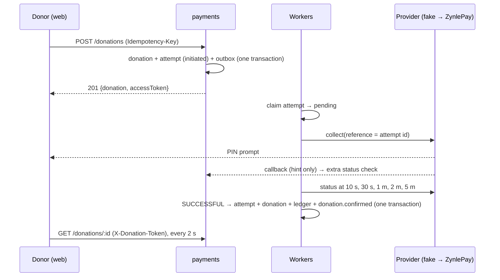

# D-01 — Donate with mobile money (pretend provider)

|                 |                                                                                                                                                                                                               |
| --------------- | ------------------------------------------------------------------------------------------------------------------------------------------------------------------------------------------------------------- |
| **Feature IDs** | D-01 guest donation, D-02 amount picker, D-03 tip, D-05 network detection, D-08 waiting screen, D-09 payment confirmation, D-10 anonymous + message, U-04 donor wall                                          |
| **Phase**       | 1 · MVP slice 6                                                                                                                                                                                               |
| **Status**      | Shipped with the pretend provider; ZynlePay sandbox in slice 8                                                                                                                                                |
| **Module(s)**   | API `modules/payments`, `infra/payments` (adapter + fake), `jobs/delayed-jobs.ts`; web `features/donate`, `/f/[slug]/give`, `/f/[slug]/give/[donationId]`; shared `donations.ts`                              |
| **ADRs**        | [0007 Guest donations](../architecture/decisions/0007-guest-donations-and-payment-attempts.md), [0006 Ledger and jobs](../architecture/decisions/0006-ledger-enforced-in-the-database-and-in-process-jobs.md) |

## 1. Summary

Anyone can give to a published fundraiser with an MTN or Airtel number, without an account:

1. pick an amount, a tip and a number;
2. show a name or give anonymously, and add a message if they like;
3. approve the prompt on their phone with their PIN;
4. see the result.

Successful gifts go into the ledger and appear on the fundraiser's donor wall, and the total goes up.

Until slice 8 the "network" is pretend: in development, you play it from the waiting screen (approve, decline, time out, unclear).

## 2. Rules agreed (2026-11-24)

| Rule                    | Value                                                                                                |
| ----------------------- | ---------------------------------------------------------------------------------------------------- |
| Smallest / largest gift | K5 / K50,000, whole kwacha                                                                           |
| Quick amounts           | K50, K100, K200, K500, Other                                                                         |
| Tip                     | 10% suggested (rounded to whole kwacha); 0%, 5%, 15% or a custom amount; up to K5,000                |
| Network fee (pretend)   | 2% of what the donor pays, split in proportion between the gift and the tip                          |
| Example                 | K100 gift + K10 tip → donor pays K110 → fee K2.20 → fundraiser gets **K98**, Fundizo keeps **K9.80** |
| Networks                | MTN (096/076), Airtel (097/077). Zamtel: "not supported yet"                                         |

## 3. Flow

**Screens:**

- **Donate:** `/f/<slug>/give`. Phone: header and form, with a sticky pay bar. Desktop: the form beside a fundraiser summary.
- **Waiting:** "Check your phone". It shows the steps and a 2-minute countdown, and starts with "Sending the prompt…" until the prompt has really gone out.
- **Thank you:** progress towards the goal, the reference, and share buttons.
- **Didn't go through:** the reason in plain words, plus **Try again**.
- **Expired:** **Send the prompt again**, offered only after the prompt has expired (no double charge; ADR 0007).
- **We're confirming with MTN/Airtel:** "Please don't pay again". Shown for `unknown`; never success.
- **Another device:** "We can't show this gift here". A gift's progress only shows where it was started.
- **Campaign page:** working **Donate** buttons (a fixed bar on phones), the donor count, and the **donor wall**.

## 4. API

| Method & path                                                                                          | Auth                             | Body                    | Result                                                                                        |
| ------------------------------------------------------------------------------------------------------ | -------------------------------- | ----------------------- | --------------------------------------------------------------------------------------------- |
| `POST /donations`                                                                                      | CSRF header + `Idempotency-Key`  | `CreateDonationRequest` | 201 `{donation, accessToken}`; 400 fields; 404 not published; 409 `idempotency_conflict`; 429 |
| `GET /donations/:id`                                                                                   | `X-Donation-Token`               | —                       | 200 `{donation}` (404 without the right token)                                                |
| `POST /donations/:id/attempts`                                                                         | token + CSRF + `Idempotency-Key` | `{phone?}`              | 201 `{donation}`; 409 `payment_in_progress` while open, after success, or after 5 tries       |
| `GET /public/campaigns/:slug/donations`                                                                | public                           | —                       | `{donorCount, donations[{name                                                                 | null, amountNgwee, message, createdAt}]}` |
| `POST /payments/callbacks/fake`                                                                        | provider signature (no CSRF)     | provider's body         | 200 / 401. Only queues a status check                                                         |
| `GET /dev/payments`, `POST /dev/payments/:reference/decide`, `POST /dev/payments/donations/:id/decide` | dev only                         | `{outcome}`             | Play the pretend network                                                                      |

`DonationView` = id, reference (`FZ-XXXXXXXX`), status (`pending | successful | failed | expired | unknown`), failureReason, amount, tip, total, network, phone (local format, token holder only), donorName, anonymous, campaign {slug, title}, promptSent, promptExpiresAt, canRetry.

## 5. Data

Migration `0007_donations`:

- **`donations`:**
  - `campaign_id` (no foreign key across modules);
  - amount, tip, `network_fee_ngwee`;
  - `donor_name` (null if anonymous), `message`, `phone_e164`, `network`, `status`;
  - `idempotency_key` (unique) and `request_hash`;
  - `settled_at`.
- **`payment_attempts`:**
  - provider and network as separate fields;
  - `phone_e164`, `amount_ngwee` (gift + tip), `status`;
  - `idempotency_key` (unique), `provider_ref`, `failure_reason`, `fee_ngwee`;
  - check count and timestamps.
- **Partial unique index:** one open attempt per donation.
- **Check constraints:** statuses and networks are closed sets.
- **Grants:** the app login can't DELETE or TRUNCATE either table.

**Ledger on success (`donation_settled`, keyed by the attempt):**

- clearing (provider + network): Dr `total − fee`;
- network fees: Dr `fee on tip`;
- campaign: Cr `gift − fee on gift`;
- tips: Cr `tip`.

## 6. Configuration

| Setting                    | Default                           | Notes                                                 |
| -------------------------- | --------------------------------- | ----------------------------------------------------- |
| `PAYMENT_PROVIDER`         | `fake`                            | Production refuses `fake`; `zynle` arrives in slice 8 |
| `PAYMENT_STATUS_CHECKS_MS` | `10000,30000,60000,120000,300000` | When to ask the provider (after the prompt)           |

## 7. Security & privacy

- **Money rules:**
  - no double charge: one open attempt (DB), idempotency keys, and the attempt id as the provider reference;
  - callbacks are hints;
  - `unknown` is never success;
  - settlement is one transaction.
- **Guest access:**
  - status is readable only with the device's token (HMAC, compared in constant time);
  - wrong or missing tokens look like "not found".
- **Phone numbers:**
  - stored in E.164;
  - never on the donor wall or in public responses;
  - masked in logs (`+26096***101`), and `phoneE164` is redacted by the logger;
  - the fake network stores only masked numbers.
- **Validation:** every input uses the shared strict schemas (unknown fields refused; amounts whole ngwee, never floats). Messages are plain text, escaped by React.
- **Rate limits:** 30 donation requests per IP per hour, 10 per number per hour, 5 prompts per donation.
- **PIN:** Fundizo never asks for a PIN; the donor approves on their own phone.

## 8. Failure modes

| Situation                                                        | What happens                                                                | Test                   |
| ---------------------------------------------------------------- | --------------------------------------------------------------------------- | ---------------------- |
| Double tap / flaky network on Pay                                | Same idempotency key → same donation, one prompt                            | ✅ API + web           |
| Same key, different gift                                         | 409 `idempotency_conflict`                                                  | ✅ API                 |
| Not enough money / wrong PIN / cancelled                         | Reason in plain words, Try again                                            | ✅ API + web + browser |
| Prompt not approved in 2 min                                     | Expired → Send again                                                        | ✅ API                 |
| No final answer after the last check                             | `unknown`: "Please don't pay again"; retry refused; later answer settles it | ✅ API + web + browser |
| Ambiguous network answer                                         | `unknown` until resolved                                                    | ✅ API                 |
| Forged or unsigned callback                                      | 401, nothing changes                                                        | ✅ API                 |
| Genuine callback claiming success while the network says pending | Nothing changes                                                             | ✅ API                 |
| Settlement applied twice                                         | Ledger records it once                                                      | ✅ API                 |
| Second open attempt inserted directly                            | Database refuses                                                            | ✅ API                 |
| Opened on another device                                         | "We can't show this gift here"                                              | ✅ web                 |

## 9. Testing

- **Shared:** amount, tip and phone rules; `suggestedTip` rounding.
- **API:** `test/donations.e2e-spec.ts` (19 tests, real Postgres, Redis and BullMQ, fast check schedule). Covers success with the exact fee split, the donor wall, anonymous gifts, idempotency races, double settlement, the one-open-attempt index, decline → retry → success, expiry, unknown → late success, ambiguous, callbacks, the token and validation.
- **Web:** `features/donate/donate.spec.tsx` (form maths and request, validation, custom and anonymous gifts, waiting → thank you, unknown never success, retry, other device). The campaign page test covers the Donate link and the empty donor wall.
- **Browser (Chromium):**
  - desktop light: K200 + 10% tip through MTN, approved; the fundraiser shows **K196**, and the donor wall shows the name and message;
  - phone dark: K50 anonymous through Airtel → not enough money → try again → unclear answer → approved → thank you;
  - no horizontal scroll and no page errors.

## Changelog

| Date       | Change                             |
| ---------- | ---------------------------------- |
| 2026-11-24 | Slice 6 shipped (pretend provider) |
