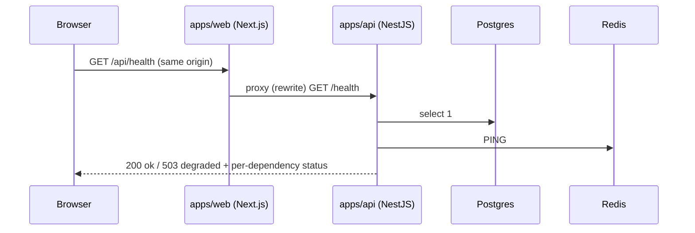

# F-01 — Skeleton: monorepo, API, web shell, database, CI

|                 |                                                                                                                            |
| --------------- | -------------------------------------------------------------------------------------------------------------------------- |
| **Feature IDs** | F-01 (done), F-02 (CI part), F-04 (local config part)                                                                      |
| **Phase**       | 0 · MVP slice 0                                                                                                            |
| **Status**      | Shipped                                                                                                                    |
| **Module(s)**   | `apps/api` (health, config, database, redis), `apps/web` (layout, status), `packages/shared`                               |
| **ADRs**        | [0001](../architecture/decisions/0001-baseline-architecture.md), [0003](../architecture/decisions/0003-slice-0-tooling.md) |

## 1. Summary

The foundation every later slice builds on: a pnpm + Turborepo monorepo with a NestJS API, a responsive Next.js web app and a shared contracts package. Postgres and Redis run locally in Docker. Migrations are wired up, and GitHub Actions runs every check on each push.

## 2. What you can see

- **Home page** (`/`): what Fundizo is and how it works. It is responsive: two columns and inline navigation on desktop; stacked, with a menu button, on phones. Light and dark follow the device.
- **Status pill** in the footer of every page: "All systems working", "Some services are down" or "Can't reach Fundizo's servers".
- **System status page** (`/status`): API, database and background-jobs status, refreshed every 10 seconds.

## 4. Flow

The browser **never calls the API directly**. `/api/*` on the web origin is proxied to the API, so later login cookies are first-party and no CORS is needed. The API enables no CORS at all.

## 5. API

| Method & path | Auth | Response (`packages/shared`) | Notes                                                                                                              |
| ------------- | ---- | ---------------------------- | ------------------------------------------------------------------------------------------------------------------ |
| `GET /health` | none | `HealthResponse`             | 200 when everything is up, 503 when degraded (so a load balancer stops routing traffic); `Cache-Control: no-store` |

## 6. Data model

No tables yet. Migration `0000_baseline` proves the pipeline (`pnpm db:migrate`, recorded in `drizzle.__drizzle_migrations`).

## 9. Security & privacy

- Config is validated at boot with Zod. **Production has no defaults**, so a missing secret stops the app instead of falling back to dev values. Errors name the bad keys, never their values.
- Helmet security headers on the API; security headers on the web app; `x-powered-by` removed.
- The pino logger redacts authorization, cookies, OTPs, phone numbers, tokens and passwords; health polls are not logged.
- Docker services bind to `127.0.0.1` only; dev passwords are clearly named `*_dev_only`.
- pnpm refuses packages published less than 14 days ago; only `esbuild` may run install scripts.
- CI runs with `contents: read` permissions only.

## 10. Failure modes & edge cases

| Situation                    | What happens                                                     | Covered by test?         |
| ---------------------------- | ---------------------------------------------------------------- | ------------------------ |
| Redis down                   | `/health` 503, `redis: down`; pill says "Some services are down" | ✅ API integration + web |
| API unreachable              | Pill says "Can't reach Fundizo's servers"                        | ✅ web                   |
| API returns a malformed body | Treated as unreachable (never trusted)                           | ✅ web                   |
| Bad config in production     | App refuses to start, naming the keys                            | ✅ unit                  |
| A dependency hangs           | Each check times out after 2 s                                   | logic                    |

## 12. Testing

- `packages/shared`: schema tests.
- `apps/api`: config unit tests; `/health` integration tests against real Postgres + Redis, including Redis down.
- `apps/web`: status pill/panel (ok, 503, network error, malformed), header and phone menu.
- CI: format check, migrations, typecheck, lint, tests, build, with Postgres and Redis service containers.

## Changelog

| Date       | Change          |
| ---------- | --------------- |
| 2026-11-23 | Slice 0 shipped |
