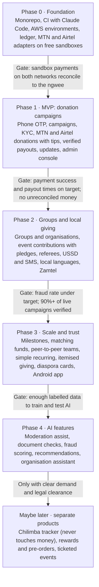
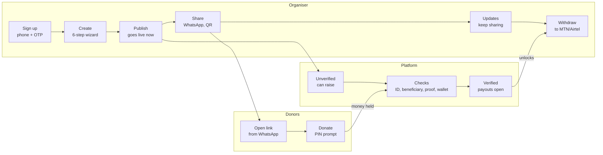
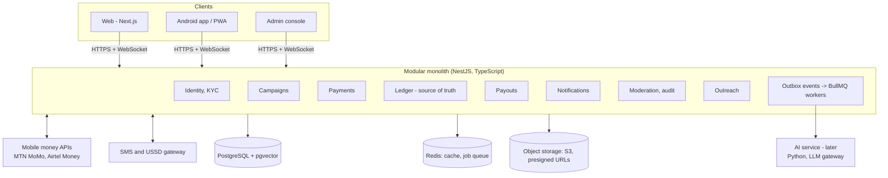

# Fundizo — Local Fundraising Platform: Product & Technical Specification

Nov 20, 2026 · @Mungeli ONE

## What a project like this needs

This doc covers the full spec for a GoFundMe-style platform built for Zambia, where people give through mobile money, at funerals and weddings, through churches, and from the diaspora. Fundizo is the product name (it replaced the working name "Harambee"). Every project like this needs the items below, roughly in this order, and each one is a section of this doc.

1. **Problem statement**: what is broken today, and for whom.
2. **Who is affected**: the people who feel the problem and what it costs them.
3. **Vision, goals and success metrics**: what "working" looks like, with numbers.
4. **Account types, roles and verification**: individuals, groups and organisations, what each role can do, and how people and campaigns are verified.
5. **Fundraising models**: the different ways money (and goods) can be raised, including local traditions.
6. **Features and phased roadmap**: what ships first, and what waits.
7. **The core flow**: the step-by-step experience for organisers, donors and groups.
8. **Trust, safety, compliance and money flow**: who holds the money, verification, fraud and the law; then the MTN and Airtel mobile money integration in detail.
9. **Non-functional requirements**: speed, uptime, security, low-end phones and data cost.
10. **Architecture and tech stack**: how the system is built so it can grow, including AI.
11. **Data model**: the core tables.
12. **AI roadmap**: where AI helps, and when.
13. **Risks, open questions and next steps**: what could go wrong, the decisions still to be made, and what to do first.

**Decisions so far:** the market is Zambia; payments launch with **MTN MoMo and Airtel Money** only (Zamtel, cards and banks come later); revenue comes from **optional donor tips**, with no platform fee for now (this can change later); and the system is built fresh, with no legacy code.

## Problem statement and who is affected

**Problem statement.** Zambians already raise money from one another all the time, for hospital bills, funerals, school fees, weddings, church buildings and boreholes. They mostly do it through WhatsApp groups and a single person's mobile money number. Donors get no proof the need is real, no record of where the money went, and no protection from scams. Organisers end up mixing donations with their own money and struggle to show accountability. Global platforms don't fill the gap: GoFundMe pays out in only 20 countries, and Zambia isn't one of them.

**Why now.** Zambia's financial inclusion rose to 80.1% in 2025 (from 69.4% in 2020), driven mainly by mobile money ([Zambia Monitor, FinScope 2025](https://www.zambiamonitor.com/?p=85372)). In 2025, mobile subscriptions reached 26.2 million and internet users 14.7 million ([OpenZambia](https://www.openzambia.com/lifestyle/2026/3/29/zambias-mobile-and-internet-subscribers-hit-record-highs)). Families abroad already send funeral contributions home by mobile money and banking apps ([NewsDay](https://www.newsday.co.zw/international/article/200048790/digital-kwacha-how-technology-is-transforming-philanthropy-in-zambia)). The payment rails exist. What's missing is the layer of trust and transparency on top of them.

**One-line version:** *People in Zambia who need help, and the people who want to help them, have no trusted, transparent and mobile-money-native way to raise, give and track money together.*

### Who is affected

| Group | Their pain today | What it costs them |
| --- | --- | --- |
| People facing emergencies (medical referrals, accidents, fires) | Rely on one relative's phone number and word of mouth in WhatsApp groups | Slow fundraising, often too late; little reach beyond their own circle |
| Bereaved families | Funeral contributions arrive in many phones, plus cash in envelopes | Disputes over totals, money lost between relatives, no record |
| Students and parents | School and university fees fall due all at once | Learners drop out or are barred from exams |
| Community groups, churches, schools | Building or borehole projects take years to fund by in-person collections | Projects stall; donors can't see progress |
| NGOs and small charities | Global tools don't pay out locally or accept mobile money | High fees, cash handling, weak donor reporting |
| Donors in Zambia | Can't tell real appeals from scams | Give less, or only to people they know personally |
| Diaspora donors | Remittance fees and no proof the money was used as intended | Give less often, or through informal channels |
| Couples and families planning events | Contribution lists kept on paper or in a WhatsApp chat | Forgotten pledges, awkward follow-ups |

## Vision, goals and success metrics

**Vision:** Zambia's most trusted place to raise and give money together, whether that's a hospital bill, a funeral, a borehole or a wedding, paid with the mobile money people already use.

**Product principles**

- **Mobile money first.** MTN MoMo and Airtel Money at launch. Zamtel, cards (mainly for the diaspora) and banks are added later through the same payment layer.
- **Trust is the product.** Verify beneficiaries, keep a public money trail, and pay out against proof.
- **Built for low-end phones and costly data.** Pages load on 3G, images are compressed, there's a USSD/SMS fallback, and links share well on WhatsApp.
- **Local customs are features, not edge cases.** Funeral contributions, chilimba, pledges and in-kind giving each get proper support.
- **Grow one step at a time.** Each fundraising model plugs into the same core: campaign, payment, ledger and payout.

**Success metrics.** These are proposed 12-month targets after the MVP launches. Adjust them once there's real data.

| Metric | Why it matters | Proposed target |
| --- | --- | --- |
| Payment success rate (initiated to confirmed) | Failed mobile money prompts kill donations | 85% or higher |
| Time from campaign creation to first donation | Shows sharing and onboarding work | Under 24 hours (median) |
| Payout time after an approved request | Speed builds trust | Under 48 hours |
| Verified campaigns as a share of all live campaigns | Core trust signal | 90% or higher |
| Confirmed fraud rate (by value) | Must stay near zero | Under 0.1% |
| Repeat donors | Shows people trust the platform | 30% or more within 6 months |
| Share of donations from the diaspora | Validates card and remittance work | Track from Phase 3 |

**Non-goals for now:** lending or investment crowdfunding (that needs Securities and Exchange Commission rules), crypto, holding customer money ourselves without a licence, and countries outside Zambia.

## Account types, roles and verification

Everyone starts as an individual with a phone number. Groups and organisations are shared spaces that individuals create and run together. Verification is progressive: anyone can start raising in minutes, but **money only leaves once both the people and the campaign are verified**.

### Account types

| Type | Who | How it's created | Payouts go to | Phase |
| --- | --- | --- | --- | --- |
| Donor (guest) | Anyone with MTN or Airtel | No account; they just pay | n/a | 1 |
| Individual | Anyone 18 or older with a Zambian number | Phone number + OTP | Their own verified wallet, or the beneficiary's | 1 |
| Group (informal) | Family, funeral or wedding committee, church fellowship, alumni, club | An individual creates it and invites members by phone | A verified treasurer's wallet, under the group's approval rule | 2 |
| Organisation (registered) | NGO, church, school, registered club, company CSI | A group that uploads its registration documents | An MTN/Airtel business wallet in the organisation's registered name (bank accounts later) | 2 |

A beneficiary can be anyone, including a child; the organiser must be an adult. A group can become an organisation later without losing its campaigns, members or history.

### Roles

**On an individual's campaign:** the **organiser** (owner) controls everything. Up to 3 **co-organisers** can share, post updates and thank donors, but can't withdraw or change the payout wallet. The **beneficiary** confirms the campaign, receives the money and can post thank-you messages.

**Inside a group or organisation:**

| Action | Owner | Treasurer | Member |
| --- | --- | --- | --- |
| Edit profile, invite or remove members, assign roles | Yes | No | No |
| Create a campaign | Yes | Yes | Draft only; an owner or treasurer publishes |
| Share, post updates, thank donors | Yes | Yes | Yes |
| Request a withdrawal | Yes | Yes | No |
| Approve a withdrawal | Yes | Yes | No |
| Change the payout wallet | Needs a second approval + 48-hour wait | Needs a second approval + 48-hour wait | No |

**Withdrawal approval rule.** A group chooses "1 approval" or "2 approvals". The default is 2 whenever the group has two or more owners or treasurers. The person who requests a withdrawal can never be the one who approves it. Owners and treasurers must be ID-verified. This mirrors how committees already handle cash, with two signatories.

### Verifying people

| Level | What's checked | Unlocks |
| --- | --- | --- |
| 0 Guest | Nothing; MTN or Airtel confirms the payer | Donating |
| 1 Phone | OTP to the phone number | Creating and publishing campaigns; receiving donations (held until verified) |
| 2 ID | NRC (or passport) front and back; a live selfie matched to the ID photo; name matched to the registered MTN/Airtel wallet name | Withdrawals; being a group owner or treasurer |
| 3 Organisation | Registration certificate (PACRA, Registrar of Societies or NGO registration); a letter authorising the representative; the representative at Level 2; a wallet in the organisation's name | Organisation badge and wallet; Phase 3 features (matching funds, peer-to-peer teams) |

For good UX, ask for ID only when it unlocks something (usually the first withdrawal) and say why in one line. Use camera guides for the NRC. Automatic checks should answer in minutes; human review within 24 hours (4 hours for funerals). Every rejection comes with a clear reason and a retry button.

### Verifying campaigns

A campaign is verified separately from its organiser, because a verified person can still post a false story. A campaign gets the **Verified** badge when all of these pass:

1. **Organiser** is at Level 2.
2. **Beneficiary confirms.** When the money is for someone else, the beneficiary gets an SMS: "\[Name\] started a fundraiser for you: '\[title\]'. Reply YES to confirm, or NO if you don't know about it." This works on any phone. If the beneficiary can't respond (a child, a patient in ICU, someone who has died), a next of kin or guardian confirms instead and states their relationship.
3. **Evidence** matching the category (table below).
4. **Payout wallet:** the registered name on the MTN/Airtel wallet matches the beneficiary (for groups, the treasurer).
5. **Automatic checks:** no duplicate photos, no NRC or phone number reused across campaigns, no banned content.

| Category | Evidence | Fast path |
| --- | --- | --- |
| Medical | Doctor's letter, hospital invoice or referral | — |
| Funeral | Burial permit, or confirmation from a referee (pastor, headman, employer) | Family representative at Level 2 + one of these = verified the same day |
| Education | Fee statement or admission letter | — |
| Emergency (fire, accident) | Photos plus a referee | — |
| Community project | Letter from a recognised local body, or a referee | — |
| Event (wedding, kitchen party) | None; the organiser is the beneficiary | Verified once the organiser is at Level 2 |
| Any campaign by a verified organisation | Covered by the organisation's verification | Verified at publish, unless flagged |

**Rules for unverified campaigns.** They can raise money but can't withdraw. The page shows a calm "Verification in progress" label, not a warning. After 30 days unverified, the campaign is paused and donors are offered refunds. A verified campaign is checked again if its beneficiary, payout wallet or story changes materially. Donors can tap the badge to see exactly what was checked.

## Fundraising models

Fundraising starts with one model, **donation campaigns**, and everything else is built on it. The original 13 ideas are cut to 9 worth building on the core, plus 3 that are parked or belong in separate products.

**The core: donation campaigns (MVP).** Someone creates a campaign, publishes it, shares it on social media, and people donate. As on GoFundMe, the organiser keeps what's raised even if the goal isn't reached. The full step-by-step experience is in the core flow section.

**Built on the core**

| # | Model | What it adds to the core | Verdict | Phase |
| --- | --- | --- | --- | --- |
| 1 | Funeral template | No goal needed; fast verification of a family representative; same-day payouts; a live total to share with the family | Do early: it's where Zambians already give most through mobile money | 1 |
| 2 | Event contributions (weddings, kitchen parties, chilanga mulilo) | Contribution list, named gifts, thank-you messages | Strong yes: the growth engine; repeat use, and every guest list brings new users | 2 |
| 3 | Pledges | A promise now; reminders; a one-tap "pay my pledge" link | Yes, but only inside events and church drives, not as a standalone feature | 2 |
| 4 | Group and organisation fundraising | Campaigns owned by a group; treasurer approvals; verified organisation profile | Yes: committees, churches, schools, NGOs | 2 |
| 5 | Milestones (an option on any campaign) | Money released per proven milestone | Yes for big goals; costs staff review time | 3 |
| 6 | Matching funds | A sponsor matches donations up to a cap | Easy on the ledger; needs sponsors signed first | 3 |
| 7 | Peer-to-peer teams | Supporters create their own pages under one cause | Only after organisations are on the platform | 3 |
| 8 | Recurring support (simple) | Monthly reminder + one-tap payment | Simple version until MTN and Airtel support pre-approved repeat payments | 3 |
| 9 | Itemised giving | "Buy a bag of cement (K250)": money earmarked for a listed item, with proof of purchase | Replaces true in-kind giving, which is a logistics business | 3 |

**Parked, or separate products**

- **Chilimba (rotating savings):** a savings product, not fundraising. It brings defaults, disputes, and holding money between rounds (a Bank of Zambia question). If ever built, it's a separate product or a tracker that never touches the money.
- **Rewards and pre-orders:** a different market (creators, small businesses), delivery disputes, and goal-missed refunds that cost network fees both ways. Skip.
- **Ticketed charity events:** a product of its own with its own competitors. At most, later, a donation that comes with a QR code for the door.
- **Out of scope:** lending and investment crowdfunding (securities rules).

## Features and phased roadmap

There are five phases (0 to 4) plus a "maybe later" list. Each phase ends with a gate, so new fundraising models are only added once the money core has proven reliable.



Phase 1 (highlighted) is the next build. Each gate is a measurable check, not a date.

**Phase 0: Foundation (no public users)**

- Monorepo created.
- CI/CD pipeline (GitHub Actions), set up with Claude Code.
- AWS environments: staging and production, secrets management, error tracking.
- Double-entry ledger.
- MTN MoMo and Airtel Money adapters built and tested against the **free sandboxes**. Real merchant onboarding and live testing with MTN and Airtel come later, before launch.
- Deferred until closer to launch: company registration details, the legal opinion on licensing, and ODPC registration.

**Phase 1: MVP (donation campaigns)**

- Sign up with phone number + OTP; personal accounts.
- Donation campaigns by individuals, for themselves or for someone else, with up to 3 co-organisers.
- Funeral template.
- Verification of people (ID + selfie) and of campaigns (beneficiary confirmation, evidence); withdrawals unlock once verified.
- Campaign page with server-rendered link previews; one-tap sharing to WhatsApp, Facebook and TikTok.
- Donations via MTN MoMo and Airtel Money (USSD push), with an optional tip, a "cover the fees" option, anonymous giving and a message.
- SMS receipts, donor wall, and updates that notify donors.
- Withdrawals to verified MTN or Airtel wallets, with admin approval at first.
- Report button; admin console for verification review, campaign review, payout approval, refunds and daily reconciliation.
- Revenue: optional donor tip, no platform fee.

**Phase 2: Groups and local giving**

- Group accounts (families, committees, fellowships) and registered organisations, with roles and treasurer approvals.
- Event contributions with pledges and reminders.
- Referee endorsements (pastor, headteacher, clinic officer).
- USSD and SMS menu for donating and checking totals without data.
- Bemba, Nyanja and Tonga for key screens and SMS.
- Zamtel Kwacha as the third mobile money network.
- Low-risk AI: story helper and translation.

**Phase 3: Scale and trust**

- Milestones option, matching funds, peer-to-peer teams, simple recurring support, itemised giving.
- Diaspora: card payments and multi-currency display; bank payouts.
- Public transparency page per campaign; analytics for organisers and organisations.
- Native Android app.

**Phase 4: AI features**

- Moderation assist, document checks, fraud scoring, recommendations and the organisation assistant (see the AI roadmap section).

**Maybe later, as separate products:** a chilimba tracker that never touches money, rewards and pre-orders, ticketed events. Only with clear demand and legal clearance.

## The core flow, step by step

The flow rests on one idea: **publish in minutes, verify while raising, withdraw once trusted.** Organisers never wait for approval before sharing, and donors never see a half-finished campaign.



Donations start the moment the campaign is published. The money is held in the ledger while the platform runs its checks, and the Verified badge is what unlocks withdrawals.

**UX principles**

- **Fast to start:** a campaign goes live in under 10 minutes, and drafts save at every step.
- **Ask only when needed:** ID is requested when it unlocks withdrawals, not at sign-up.
- **Phone-first:** one task per screen, big buttons, works on 3G, numbers remembered on the device.
- **Always show status:** where my payment is, where my verification is, where the money went.
- **Visible trust:** the verified badge, "what we checked", and a public money trail.

### 1. Sign up (organiser): 3 screens

1. Tap **Start a fundraiser** (home page, or the footer of any campaign page).
2. Enter a phone number; the OTP is read automatically on Android.
3. Enter first and last name. Done.

No email or password. Ask for notification permission only after the first campaign is published, when the reason is obvious.

### 2. Create the campaign: a 6-step wizard

The wizard has a progress bar and a back button, and saves at every step.

1. **Who is this for?** Myself, Someone else, or My group (Phase 2). "Someone else" asks for their name, phone number and relationship.
2. **What's it for?** Category cards: Medical, Funeral, Education, Emergency, Community, Event, Other. Funeral switches to the funeral template (the deceased's name, burial date and place; goal optional).
3. **How much?** A goal in ZMW, with the hint "You keep what you raise, even if you don't reach the goal." Optional end date.
4. **Tell the story.** A title (up to 60 characters) and guided prompts: who needs help, what happened, what the money pays for, and by when. A live preview sits alongside. (AI story helper arrives in Phase 2.)
5. **Add photos.** A cover photo is required, up to 10 photos in total. Photos are compressed on the phone before upload. Sensitive medical images can be blurred.
6. **Where should the money go?** The beneficiary's MTN or Airtel number. It can be skipped for now ("Add this before your first withdrawal").

Then a **preview**, exactly as donors and WhatsApp will show it, and **Publish**.

### 3. Publish and share

The screen after publishing is the most important one in the product. It shows:

- A large **Share on WhatsApp** button with a pre-written message and link, then WhatsApp Status, Facebook, TikTok, copy link, and a **QR code** to print for a church notice board or a funeral house.
- "Start it off with your own donation."
- Invite co-organisers.
- An **Unlock withdrawals** checklist: verify your ID, beneficiary confirms, add evidence, add a payout wallet. Each item shows its status.

### 4. Verify while raising

The checklist stays at the top of the organiser's dashboard, and every item is one tap. The beneficiary's confirmation SMS goes out automatically at publish. Until everything passes, the campaign page shows "Verification in progress". When the badge appears, the organiser gets a nudge: "You're verified. Share again!"

### 5. Donate (donor, no account needed)

**The campaign page, top to bottom:** cover photo, title, amount raised against the goal with the donor count, verified badge (tap to see what was checked), organiser and beneficiary names, the story, updates, recent donors and their messages, and a small Report link. A **Donate** button stays fixed at the bottom of the screen.

**The donate sheet:**

1. **Amount:** K50, K100, K200, K500 or Other.
2. **Tip:** "Organisers pay nothing. Add a tip to keep the platform running?" A suggested amount is pre-filled, and 0 and custom amounts are one tap away. It's never hidden or tricky.
3. **Cover the fees:** a tick box showing the exact fee in kwacha.
4. **Phone number:** the MTN or Airtel logo appears as you type; the number is remembered on this device.
5. **Name shown** on the donor wall, or **Give anonymously**, plus an optional message.
6. The button shows the total and network: **Pay K110 with MTN MoMo**.

**Waiting screen:** "Check your phone and enter your PIN to approve K110", with a 2-minute countdown and live status. After 30 seconds, "Didn't get the prompt? Send again" appears.

**Result:**

- **Success:** a thank-you screen, a "Share to help reach the goal" WhatsApp button, an option to get SMS updates from this campaign, and an SMS receipt.
- **Failed:** the reason in plain words (not enough balance, wrong PIN, cancelled, timed out) and **Try again** with the amount kept.
- **Not yet confirmed:** "We're confirming with MTN. You'll get an SMS within a few minutes. Please don't pay again." This one screen prevents most double payments and support calls.

### 6. Keep momentum: updates and thank-yous

The organiser dashboard shows the total raised, today's donations, the donor list and how often the link was shared. Organisers can thank donors one by one or all at once by SMS or WhatsApp, and post updates with photos that notify donors. Gentle nudges help: "No update in 7 days: post one", "You're at 80%: share again".

### 7. Withdraw

1. **Withdraw** shows the available balance (raised, minus network fees, minus earlier withdrawals) and anything still pending.
2. Choose all or part of it.
3. Confirm the destination, showing the wallet's registered name: "MTN · 096X XXX 123 · MARY BANDA".
4. Confirm with an OTP.
5. Track it: Requested → Approved → Sent → Received, with times.
6. Donors are told ("K2,000 sent to Mary Banda"), it appears in the page's money trail, and the organiser is asked to add proof of use, such as a receipt photo.

**For groups**, step 4 becomes "Waiting for a second treasurer to approve". The approver gets an SMS and a push notification with one-tap Approve or Decline.

### 8. End and close

The organiser ends the campaign (or the end date passes), donations stop, a final withdrawal goes out, and the organiser is prompted to post a final thank-you. The page stays visible as a public record.

### How the group flow differs (Phase 2)

- **Create a group:** name, type and photo; invite members by phone (SMS or WhatsApp link); assign owner and treasurers; choose the approval rule.
- **Campaigns** show "Organised by St Mary's Fellowship · 2 verified treasurers".
- **Members** can draft campaigns; an owner or treasurer publishes them.
- **Withdrawals** follow the group's approval rule.
- **Upgrade to an organisation:** upload registration documents to get the organisation badge and use an organisation wallet.

### Edge cases the flow must handle

| Situation | What happens |
| --- | --- |
| Donor was charged but the screen said failed | The payment sits in "not yet confirmed"; status checks and daily reconciliation settle it; the donor gets an SMS either way |
| Organiser loses their phone or SIM | Recovery needs ID re-verification, not just a new SIM, to stop SIM-swap fraud |
| Beneficiary replies NO | Campaign paused, reviewed by staff, donors refunded if it's fraud |
| A medical campaign's beneficiary dies | The organiser can switch it to a funeral campaign; donors are told |
| Two relatives raise for the same person | Duplicate check spots it and offers to link or merge the campaigns |
| Goal reached early | Donations stay open; the organiser can raise the goal and explain why in an update |

## Trust, safety, compliance and money flow

**Rule one: every kwacha belongs to a campaign or to the platform, and the ledger proves which.** Donors pay through MTN MoMo and Airtel Money directly into the company's business collection wallets. Payouts go out from the same networks' disbursement wallets. The double-entry ledger records who owns every ngwee. Because the company is collecting money on behalf of others, the first legal question is whether this needs Bank of Zambia authorisation. Running a payment business in Zambia requires a licence or designation under the National Payment Systems Act ([BoZ notice](https://regalert.today/document/d253f487-2878-476e-8827-848f17ed94ba/text)). If the lawyer says yes, the fallback is to route the same MTN and Airtel flows through a licensed aggregator such as [Flutterwave](https://thepaypers.com/payments-general/flutterwave-gains-payment-system-licence-from-the-bank-of-zambia--1272513) using the same adapter design, so the rest of the system doesn't change.

**Money flow**

1. A donor approves a USSD push prompt from MTN or Airtel. The money lands in that network's business collection wallet.
2. A callback or status check confirms the payment. We write ledger entries: donation → campaign balance, tip → platform revenue, network charge → network-fees account.
3. Money stays in the network wallets (and the company bank account after sweeps). A campaign's balance is just the sum of its ledger entries.
4. A withdrawal is approved, the payout goes from the matching network's disbursement wallet to the beneficiary, and the ledger records campaign → payout.
5. A daily job reconciles both networks' statements with the ledger. Any mismatch is flagged to finance before the next payout run.

**Laws and regulators to plan around** (confirm each with a Zambian lawyer)

| Area | Law or body | What it means for us |
| --- | --- | --- |
| Payments | National Payment Systems Act (2007); a new [National Payment System Act, 2026](https://zambialii.org/akn/zm/act/2026/5) has been passed but isn't in force yet | Legal opinion on collecting through our own MTN and Airtel business wallets; check whether the new Act's "aggregation collection account" rules apply to us |
| Data protection | [Data Protection Act No. 3 of 2021](https://www.zambialii.org/akn/zm/act/2021/3) | Register as a data controller with the ODPC ([registration](https://bowmanslaw.com/insights/zambia-office-of-the-data-protection-commissioner-operational/)); report breaches to the Commissioner within 24 hours ([summary](https://dig.watch/resource/data-protection-act-2021-of-zambia)); NRC images and health stories are sensitive data |
| Anti-money laundering | Financial Intelligence Centre (FIC) | KYC for organisers and beneficiaries; watch for unusual patterns; file suspicious-transaction reports |
| Mobile money tax | [Mobile Money Transaction Levy Act, 2024](https://zambialii.org/akn/zm/act/2024/25/eng@2024-12-26) | A levy on person-to-person transfers, paid by the sender; check how it applies to donations and payouts |
| Cyber security | Cyber Security and Cyber Crimes Act, 2021 | Security controls, incident handling |
| Charities and organisations | PACRA, Registrar of Societies, NGO registration | Proof of registration for organisation accounts |

**Fraud and trust controls**

- Verification levels for people, groups and campaigns (see the account types and verification section).
- Payouts only to verified destinations; a cool-off period after any change; velocity limits on new accounts.
- Duplicate detection: the same photos, NRC or phone number used across campaigns.
- Proof-of-use prompts after each withdrawal; a public transparency page.
- Donor protection policy: refund if fraud is confirmed (decide who pays for it).
- A clear refund process with MTN and Airtel (both offer reversals of completed collections).
- Content rules: no hate, politics-as-campaign, or illegal causes; graphic medical images are blurred by default.

## Mobile money integration: MTN MoMo and Airtel Money

We integrate directly with both networks' open APIs. Each network sits behind one `PaymentProvider` interface, so the donation flow is identical for both, and Zamtel, cards or an aggregator plug in later as new adapters.

**Sandbox first.** All development and automated tests run against the free MTN and Airtel sandboxes. The onboarding checklist below is needed only when moving to live testing and launch.

### Onboarding checklist

| Step | MTN MoMo | Airtel Money |
| --- | --- | --- |
| Developer portal | [momodeveloper.mtn.com](https://momodeveloper.mtn.com/); sandbox access right after sign-up ([Ericsson case study](https://www.ericsson.com/en/cases/2023/mtn-mobile-money-open-apis)) | [developers.airtel.africa](https://developers.airtel.africa/); test access reportedly isn't as open as MTN's ([developer notes](https://packagist.org/packages/chanda/airtelmomoapi)), so contact Airtel Zambia's business team early |
| Products to request | Collections (Request to Pay) + Disbursements | Collection (USSD push) + Disbursement |
| Account | A MoMo business/merchant account in the company's name (confirm with MTN that an agent line can't be used) | An Airtel Money merchant account in the company's name |
| Go-live | KYC submitted through the portal plus company documents, then production keys | KYC with Airtel Zambia, then production keys |
| Fees | MTN Zambia's collections terms list 1%–4% per transaction, deducted from the collections account, with no charge per API call ([MTN Zambia terms](https://momodeveloper.mtn.com/Zambia_Widget_productDetails)) | Negotiate, and get a written rate card for collections and disbursements |
| Settlement | Sweep from the collections account to the company bank account (allowed under the same terms) | Agree the sweep process with Airtel |

### Donation payment flow

1. The app sends `POST /donations` with the amount, tip, phone number and an idempotency key.
2. The backend normalises the number to +260 format and detects the network from its prefix (MTN 096/076, Airtel 097/077; confirm the current ranges with each operator). It creates the donation and a payment attempt in state **Initiated**.
3. The adapter calls MTN Request to Pay or Airtel's USSD push collection, with our payment-attempt ID as the reference. State becomes **Pending**.
4. The donor approves the prompt with their PIN.
5. Confirmation arrives two ways: the network's callback, and a status-check job at 10 s, 30 s, 1 min, 2 min and 5 min. Whichever lands first wins, and both are safe to repeat. Callbacks are only trusted after a status check confirms them.
6. **Successful** → ledger entries are written in one database transaction → an event goes out → SMS receipt and a live total update.
7. **Failed** or **Expired** → the donor sees the reason and can retry, which creates a new attempt. No double charge is possible.
8. **Unknown**: the network returns an unclear result (Airtel has a "transaction ambiguous" status, [TA](https://ronaldgosso.github.io/pyairtel)) or there's no final answer after 5 minutes. It's never shown as a success. Later status checks or the daily reconciliation settle it.

### Payouts and float across networks

- A payout goes out on the beneficiary's network. Money collected on MTN may need to be paid out on Airtel, so each network's **disbursement wallet needs float** (pre-funded balance).
- The ledger has one float account per network. Collections are swept to the bank every day. Disbursement wallets are topped up from the bank. The payout queue checks the float before sending, and an alert fires when it runs below a set level.
- Airtel disbursements need an RSA-encrypted PIN ([SDK notes](https://ronaldgosso.github.io/pyairtel)). Keep the PIN in the secrets manager and encrypt it at call time only.
- Before the first payout to a new wallet, check the wallet's registered name where the API offers it, and compare it with the beneficiary's KYC name.

### Tips and fees: how one payment splits

The donor approves **one prompt** for donation + tip. Network fees are charged in proportion: the campaign pays its share, and the platform pays the tip's share. Donors can tick "cover the fees" to add them on top. Example below, assuming a 2% network fee (the actual rate is still to be agreed):

| Line | Amount (ZMW) |
| --- | --- |
| Donor pays (donation 100 + tip 10) | 110.00 |
| Network fee on the donation (2%) | −2.00 |
| **Reaches the campaign** | **98.00** |
| Network fee on the tip (2%) | −0.20 |
| **Platform revenue** | **9.80** |

Check with the lawyer whether the Mobile Money Transaction Levy, which applies to person-to-person transfers ([Act](https://zambialii.org/akn/zm/act/2024/25/eng@2024-12-26)), touches our payouts to wallets.

### Reconciliation (daily)

- Pull both networks' transaction statements and match them on our reference and the network's transaction ID.
- Sort into three buckets: matched; in our ledger but not in the statement; in the statement but not in our ledger.
- Settle every **Unknown** attempt, and send finance a report. **Payouts pause automatically** if any difference is unexplained.

### The adapter contract

```typescript
interface PaymentProvider {
  readonly network: 'MTN' | 'AIRTEL'; // later: 'ZAMTEL' | 'CARD' | 'BANK'
  collect(req: CollectRequest): Promise<ProviderResult>;          // USSD push
  getCollectionStatus(ref: string): Promise<ProviderStatus>;
  disburse(req: DisburseRequest): Promise<ProviderResult>;
  getDisbursementStatus(ref: string): Promise<ProviderStatus>;
  getBalance(wallet: 'collection' | 'disbursement'): Promise<Money>;
  parseCallback(headers: Headers, body: unknown): ProviderEvent | null;
}
// Every network status maps to ours: PENDING | SUCCESSFUL | FAILED | EXPIRED | UNKNOWN
```

## Non-functional requirements

These are proposed starting targets. Revisit them after the first 3 months in production.

| Area | Requirement |
| --- | --- |
| Performance | Campaign page: first content in under 2.5 s on a 3G Android device; page under 300 KB before images; images served as WebP in under 100 KB |
| Availability | 99.5% monthly uptime for donating; payments must survive our own downtime (status polling picks up missed callbacks, and we reconcile daily) |
| Money correctness | No lost or double-counted payments: double-entry ledger, idempotency keys, database transactions, daily reconciliation |
| Security | OWASP Top 10; secrets in a secrets manager (never in git or the frontend); TLS everywhere; NRC images encrypted and served by short-lived signed URLs; 2FA for staff; least-privilege IAM |
| Privacy | Collect the minimum data; donor anonymity option; delete KYC images N years after the account closes (N set by the lawyer and FIC rules); a data-subject request process |
| Scalability | Handle a viral funeral or emergency campaign: 50 donations per second at peak, using queue-based webhook processing |
| Accessibility and reach | Works on Android 8+ in Chrome and Opera Mini; USSD/SMS fallback; local languages; plain words |
| Observability | Structured logs, traces, payment success dashboards, alerts on webhook failures and reconciliation gaps |
| Auditability | Every admin and money action logged permanently, with who, what, when and why |
| Backups | Database point-in-time recovery for 7 days or more; a restore drill every quarter |

## Architecture and tech stack

**Choice: a modular monolith in TypeScript, with a separate AI service added later.** One deployable backend, split into strict modules (identity, campaigns, payments, ledger, payouts, notifications, moderation, and so on). Modules talk to each other through internal interfaces and domain events, never by reaching into each other's tables. This keeps a small team fast now. When one module needs to scale or be owned separately (payments first, then AI), it can be pulled out into its own service without a rewrite. Starting with microservices would add infrastructure cost and slow a small team down.



Every client talks to one backend. MTN, Airtel, SMS and AI sit behind adapters, so any of them can be swapped or pulled out later.

**Key patterns**

- **Payment adapter layer.** One `PaymentProvider` interface with an MTN MoMo adapter and an Airtel Money adapter at launch. Zamtel, cards, banks or an aggregator are later adapters, not rewrites (details in the mobile money section).
- **Ledger as the source of truth** for balances. Balances are calculated from permanent double-entry ledger entries, never stored as one editable number.
- **Transactional outbox + job queue.** Domain events (DonationConfirmed, PayoutSent, and so on) are written in the same database transaction as the change, then handled by workers: status checks, SMS, receipts, analytics, and AI later.
- **Campaign types as plug-ins.** Each fundraising model defines its own rules (goal required? milestones? pledges?) behind a common interface.
- **Server-rendered public pages** so campaign links shared on WhatsApp and Facebook show a photo, title and amount raised, and load fast on 3G.
- **One repo, shared types.** API, web, admin and (later) mobile live in one monorepo and share validation schemas, so a donation request is checked by the same rules everywhere.

**Recommended stack**

| Layer | Choice | Why |
| --- | --- | --- |
| Language | TypeScript everywhere (Python only for the later AI service) | One language for API, web and mobile; types catch money bugs early; the largest local hiring pool |
| Repo | Monorepo (pnpm + Turborepo): `apps/api`, `apps/web`, `apps/admin`, later `apps/mobile`; `packages/shared` | Shared types and Zod schemas; one CI pipeline |
| Backend | NestJS on Node.js | Module system matches the modular monolith; built-in guards, validation and dependency injection |
| Database | PostgreSQL 16 | ACID transactions for the ledger; JSONB for type-specific campaign fields; pgvector for AI later |
| Data access | Drizzle ORM + SQL migrations | Typed queries you can read as SQL; no hidden behaviour in ledger code |
| Jobs | Redis + BullMQ | Payment status polling with back-off, callbacks, SMS, sweeps and reconciliation, with retries |
| Real-time | WebSocket (Socket.IO) | Donation status and live totals on the campaign page |
| Public web | Next.js (React) + Tailwind | Server rendering for link previews and SEO; light pages for 3G |
| Admin console | Separate Next.js app on a separate subdomain, staff-only 2FA | Keeps staff tools and their attack surface away from the public site |
| Mobile | PWA at launch; React Native (Expo) Android app in Phase 3 | Reuses TypeScript and the shared packages |
| SMS / OTP / USSD | A Zambian SMS and USSD aggregator (to be selected) behind a `Messaging` adapter | OTP, receipts and the Phase 2 USSD menu |
| File storage | S3, private buckets, presigned uploads; KYC in a separate encrypted bucket | Files never pass through the app servers; strict access to NRC images |
| Hosting | AWS af-south-1 (Cape Town): ECS Fargate, RDS PostgreSQL, ElastiCache Redis, S3 | Closest major cloud region; managed backups; **fixed outbound IPs through a NAT gateway**, which MTN and Airtel may need to allowlist |
| Secrets | AWS Secrets Manager | API keys and the Airtel disbursement PIN never sit in code or `.env` files in git |
| Delivery | GitHub Actions → Docker → staging → production; infrastructure as code (Terraform) | Repeatable deploys; a separate sandbox and live setup for each network |
| Observability | Sentry + OpenTelemetry into Grafana Cloud | Alerts on payment success rate, callback failures, float levels and reconciliation gaps |
| Auth | Phone OTP; short-lived JWT access tokens + rotating refresh tokens | Phone-first users; email optional |

### Design decisions

| Decision | Chosen | Alternatives considered | Why |
| --- | --- | --- | --- |
| System shape | Modular monolith | Microservices | Small team; one deploy; modules can be split out later |
| Payments | Direct MTN and Airtel APIs | An aggregator for everything | Lower fees and full control; an aggregator stays a ready fallback behind the same adapter |
| Balances | Double-entry ledger | A `balance` column on the campaign | Provable correctness; easy audits and reconciliation |
| Confirmation | Callback + status polling, both idempotent | Callback only | Callbacks get lost; polling guarantees a final state |
| Public pages | Server-rendered (Next.js) | Single-page app | WhatsApp link previews and fast first load |
| Backend language | TypeScript (NestJS) | Python (Django), Go | Same language as the web and mobile apps; Python is kept for AI |
| Cloud region | AWS Cape Town | Europe or US regions | Lower latency for Zambian users; check data-protection transfer rules |
| Revenue | Optional donor tip | A % platform fee | Keeps giving free and builds trust; can change later |

## Data model

There are 20 core tables, grouped by module. Money values are stored as whole ngwee (integer), never as floats. Every table has `id` (UUID), `created_at` and `updated_at`.

| Module | Table | Key fields | Phase |
| --- | --- | --- | --- |
| Identity | users | phone, email, name, status, kyc\_level | 1 |
| Identity | kyc\_verifications | user\_id, type (nrc, selfie, wallet\_name), status, reviewer\_id, document\_ref (encrypted) | 1 |
| Identity | groups | name, kind (informal group or registered organisation), registration\_no, approval\_rule (1 or 2), verified\_at | 2 |
| Identity | group\_members | group\_id, user\_id, role (owner, treasurer, member), invited\_by, joined\_at | 2 |
| Campaigns | campaigns | type, owner\_type (user or group), owner\_id, beneficiary\_id, verification\_status, verification\_checklist (JSONB), title, story, goal\_ngwee, currency, district, status, verified\_at, type\_config (JSONB) | 1 |
| Campaigns | beneficiaries | name, phone, relationship, confirmed\_at, confirmed\_by (self or next of kin), kyc\_status, payout\_destination\_id | 1 |
| Campaigns | campaign\_media | campaign\_id, storage\_key, kind, sort | 1 |
| Campaigns | campaign\_updates | campaign\_id, body, media, notified\_at | 1 |
| Campaigns | milestones | campaign\_id, title, amount\_ngwee, status, proof\_media, verified\_by | 3 |
| Campaigns | pledges | campaign\_id, donor\_contact, amount\_ngwee, due\_date, status | 2 |
| Campaigns | inkind\_items / inkind\_pledges | item, qty\_needed, qty\_pledged, delivered | 3 |
| Payments | donations | campaign\_id, donor\_id (nullable), amount\_ngwee, tip\_ngwee, network\_fee\_ngwee, cover\_fees, anonymous, message, status | 1 |
| Payments | payment\_attempts | donation\_id, provider, provider\_ref, msisdn, network, status, raw\_webhook, idempotency\_key | 1 |
| Ledger | ledger\_accounts | owner\_type (campaign, platform revenue, network fees, MTN float, Airtel float), owner\_id, currency | 1 |
| Ledger | ledger\_entries | txn\_id, account\_id, debit\_ngwee, credit\_ngwee, ref\_type, ref\_id (permanent, never edited) | 1 |
| Payouts | payout\_destinations | owner\_id, type (wallet, bank), number, verified\_name, verified\_at | 1 |
| Payouts | payouts | campaign\_id, destination\_id, amount\_ngwee, status, requested\_by, approvals (who and when), provider\_ref | 1 |
| Trust | reports | target\_type, target\_id, reason, status, handled\_by | 1 |
| Platform | notifications / outbox\_events | user\_id, channel (SMS, email, push, WhatsApp), template, payload, sent\_at | 1 |
| Platform | audit\_logs | actor\_id, action, target, before, after, reason, ip | 1 |

Type-specific fields (for example a funeral's deceased name and burial date, or an event's date) live in `campaigns.type_config`, validated by the campaign type's schema. This means adding a new fundraising model doesn't need a schema migration.

## AI roadmap

AI comes after the money core is trustworthy, and it always helps a human rather than deciding alone on money or bans. The architecture is ready for it now: the event outbox feeds an AI service, pgvector stores embeddings in the same database, and every AI call goes through one gateway that logs it, caps cost and lets us switch models.

| Order | Feature | What it does | Risk |
| --- | --- | --- | --- |
| 1 | Story helper | Turns a few answers (or a voice note in Bemba or Nyanja) into a clear campaign story and title; the organiser edits it before publishing | Low |
| 2 | Translation | Story and updates in English, Bemba, Nyanja and Tonga | Low |
| 3 | Moderation assist | Flags banned content, graphic images and copied stories for human review | Medium |
| 4 | Document check | Reads NRCs and hospital or school invoices; checks that names and amounts match the campaign; a human approves | Medium |
| 5 | Fraud scoring | Risk score per campaign and payout from behaviour signals (velocity, reused photos or numbers); high scores go to manual review | High; needs labelled data first |
| 6 | Smart sharing | Suggests the best time and channel to share, and drafts WhatsApp messages | Low |
| 7 | Donor discovery | Recommends campaigns by district and interest; semantic search | Medium |
| 8 | Organisation assistant | Answers "how much did we raise from the diaspora in March?" over the organisation's own data | Medium |

**Data to start collecting now** (with consent) so AI can work later: moderation decisions with reasons, confirmed fraud cases, payment failure reasons, and campaign outcomes.

## Risks, open questions and next steps

**Top risks**

Decided for now: the licensing question and the plan for a fraudulent campaign going viral are **deferred until closer to launch**. The MVP still blocks withdrawals until a campaign is verified, which limits the damage in the meantime.

| Risk | Effect | Mitigation |
| --- | --- | --- |
| Running money without the right licence | Shutdown, penalties | Legal opinion before launch; a licensed aggregator as the fallback route |
| A fraudulent campaign goes viral | Trust collapses | Withdrawals blocked until KYC passes, payout review, donor protection policy |
| MTN or Airtel outage, lost callbacks, empty payout float | Lost donations, angry users | Callback + polling, float alerts, daily sweeps, an aggregator fallback behind the adapter, a status page |
| Mobile money fees and levy eat small donations | Donors give less | Show fees clearly; minimum donation; negotiate MTN and Airtel rates |
| Scope creep across 13 fundraising models | Nothing ships | Strict phase gates |

**Open questions** (each is a decision for you)

- [x] Product name: **Fundizo**.
- [ ] Suggested tip default (for example 10%), and whether to add a small platform fee later.
- [ ] Network fees: deducted from the donation by default with a "cover the fees" option (proposed), or absorbed by the platform?
- [ ] Who pays for fraud refunds under the donor protection policy?
- [ ] Are any charity or public-collection permits needed? (Lawyer)
- [ ] Does collecting through our own MTN and Airtel business wallets need Bank of Zambia authorisation? (Lawyer)

**Next steps**

1. Finish the CI pipeline and the AWS staging environment.
2. Sign up on the MTN and Airtel developer portals and get sandbox keys.
3. Build the ledger, then the MTN adapter, then the Airtel adapter.
4. Run the donation flow end to end against the sandboxes.
5. Write the Phase 1 backlog from the feature list.
6. Before launch: company registration, legal opinion, ODPC registration, live MTN and Airtel onboarding.

### Sources

- [GoFundMe: countries supported](https://support.gofundme.com/hc/articles/360001972748) and [Mexico becomes the 20th country](https://gofundme.com/c/newsroom/gofundme-expands-to-mexico)
- [FinScope 2025 financial inclusion, Zambia Monitor](https://www.zambiamonitor.com/?p=85372)
- [Mobile and internet subscribers 2025, OpenZambia](https://www.openzambia.com/lifestyle/2026/3/29/zambias-mobile-and-internet-subscribers-hit-record-highs)
- [Mobile money and Zambian philanthropy, NewsDay](https://www.newsday.co.zw/international/article/200048790/digital-kwacha-how-technology-is-transforming-philanthropy-in-zambia)
- [MTN MoMo Zambia collections terms and fees](https://momodeveloper.mtn.com/Zambia_Widget_productDetails)
- [MTN MoMo Open API: sandbox and go-live, Ericsson](https://www.ericsson.com/en/cases/2023/mtn-mobile-money-open-apis)
- [Airtel Africa Developer Portal launch, Connecting Africa](https://connectingafrica.com/fintech/airtel-launches-africa-developer-portal)
- [Airtel Money API statuses, refunds, PIN encryption (pyairtel docs)](https://ronaldgosso.github.io/pyairtel)
- [National Payment System Act, 2026 (not yet in force), ZambiaLII](https://zambialii.org/akn/zm/act/2026/5)
- [Data Protection Act, 2021, ZambiaLII](https://www.zambialii.org/akn/zm/act/2021/3)
- [Mobile Money Transaction Levy Act, 2024, ZambiaLII](https://zambialii.org/akn/zm/act/2024/25/eng@2024-12-26)
- [RippleWave: mobile money crowdfunding with USSD, Zambia](https://money.hipipo.com/?p=7842) (an existing local player to study)
